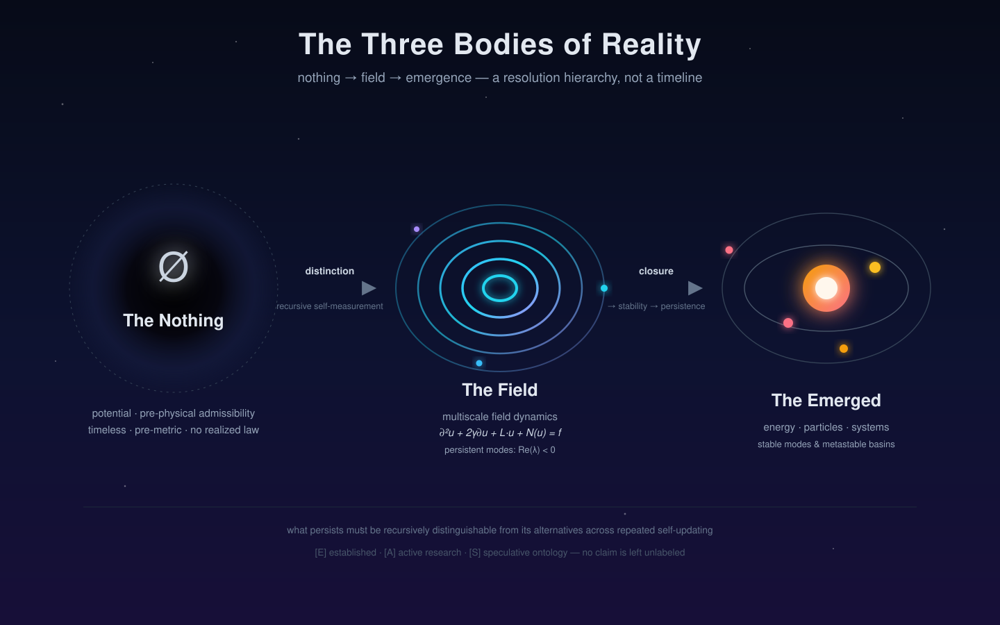

# Multiscale Field Dynamics Research 2026 — RHUFT

A research archive for modeling and **testing** recursive, multiscale field dynamics — the
"RHUFT" line of work — across geometry, field equations, resolution-hierarchy transfer, and
neural-network-compatible representations.

> **Epistemic policy (non-negotiable).** Every claim carries a label:
> `[E]` established · `[A]` active research · `[S]` speculative ontology.
> No fabrication, no roleplay. Unsupported claims are flagged, never dressed up as fact.
> Ontology (interpretation), dynamics (equations), and phenomenology (numbers) are kept separate.

---

## The three bodies: nothing → field → emergence



This project does **not** derive the three bodies from first principles. It *maps* them onto a
decomposition that can be computed against. They are a **resolution hierarchy**, not a timeline —
the corpus is explicit that the field does not "evolve in time"; the scale index `n` is the
fundamental parameter, and physical time is emergent.

### 1. The Nothing — potential / pre-physical admissibility `[S]`

The uninstantiated space of possibilities *before* any distinction is actualized. In the source
ontology this is **Layer 0 — ontological potential**: "not ordinary physical vacuum … pre-physical
admissibility; timeless, pre-metric or proto-metric, unconstrained by realized law, not yet
partitioned into observer and observed."

- Rigorous content: a configuration/possibility space with no realized dynamics — the set of
  admissible field states *before* a measurement interaction selects one.
- What it is not: a claim that "nothing" is a substance or a region. It is a boundary condition on
  description, not an object.

### 2. The Field — recursive self-measurement / multiscale field dynamics `[A]`

Where the primitives (distinction, relation, measurement, closure, stability, scale) become active.
The rigorous object is a damped, geometry-constrained operator equation:

```
∂²u + 2γ ∂u + L·u + N(u) = f      (u = state, L = geometry-dependent linear operator,
                                   N = nonlinear coupling, f = forcing, γ = damping)
```

- `L` is fixed by the domain topology (sphere → closed isotropic modes; torus → recirculation /
  doubly-periodic modes; lattice → discrete message-passing). `[E]`
- Persistence is read off the spectrum: **Re(λ) < 0** for continuous-time stability; oscillatory
  (`Im λ ≠ 0`) vs decaying (`Re λ ≪ 0`) modes. `[E]`
- "Resonance pocket" / "metastable basin" is the model-hypothesis reading of a persistent mode. `[A]`

### 3. The Emerged — energy, particles, systems `[A]`

What survives recursive updating becomes *structure*, not new substance. The minimal law from the
source corpus:

> "whatever persists must be recursively distinguishable from its alternatives across repeated
> self-updating."

- **Closure** (loop → sphere → torus → nested toroidal recursion) is the geometric signature of
  persistence. `[A]`
- **Energy / particles** are stabilized, localized, persistent modes of the field — metastable
  basins and mode-locked regions — *described* as particles, not added as ingredients. `[A]`
- **Systems** are hierarchies of closure: persistent modes that bind into further persistent modes
  (atoms → molecules → cells → minds). `[S]`

### The bridge: RHUFT as resolution-hierarchy transfer

The term "RHUFT" is operationalized in this repo as a **resolution-hierarchy transfer map**: a
family of transformations (dyadic coarse-grain / lift, RG orbits, scale residuals) that carry field
states between resolutions while preserving diagnostically relevant structure. The rigorous
requirement is that **a persistence claim must not depend arbitrarily on truncation** — a structure
is "real" only if its signature survives coarse-graining with small fixed-scale residual. `[A]`

### Neural networks close the loop `[A]`

The field's stable, geometry-aware, resolution-compatible summaries (eigenmode coefficients,
coarse-grained state) are the latent representation a network consumes; conversely a network is an
adaptive operator acting back on field-derived latent structure. This is the *bidirectional
field-latent operator coupling*, and whether it actually works is an open question here, not a
conclusion.

---

## Repository map

```text
README.md                       this file — purpose, ontology, and the three bodies
INDEX.md                        navigation index
00-INDEX.md                     multiscale-framework bootstrap index (method rules, roadmap)

docs/
  ontology.md                   the three layers of reality, formally stated
  three-bodies.svg              the visual above
  RHUFT_v6.0_Master_Index.md    master navigation for the v6.0 corpus
  PHILOSOPHICAL_FOUNDATION.md   the core philosophical position
  notes/phenomena/              38 phenomena (v6, corrected & labeled)
  notes/technologies/           16 technologies (v6, labeled [SPEC]/[PHIL])

models/
  equations/                    the 4 core chapters + the v6.1 geometric-resonance grid
  simulations/                  (reserved)
  experiments/                  (reserved)

notebooks/
  analysis/                     Wolfram notebooks (RHUFT 01–04, field dynamics, OPF series)

01-inventory/                   what the RHUFT corpus actually contains (with line citations)
02-scales-of-physics/           the stable-scale hierarchy ("octaves")
03-research-notes/              sourced findings from modern physics
04-framework/                   the framework restructured from scratch
05-tests/                       numeric / falsifiability checks
06-scales-audits/               per-file rigor audits and correction changelogs

archive/prior-iterations/       superseded v5-era material (kept for provenance, not canonical)
data/  results/  scripts/  references/   reserved placeholders
```

## Getting oriented

1. Start with `docs/ontology.md` for the three-layer ontology and `docs/RHUFT_v6.0_Master_Index.md`
   for the theory corpus.
2. The **current** theory content is the `v6_*` set under `models/equations/` and
   `docs/notes/` — the honest, corrected rewrite. Older v5-era files live in `archive/` and are
   superseded.
3. `06-scales-audits/` is where claims are checked for rigor; read an audit alongside its source
   file to see the labeling policy in action.
